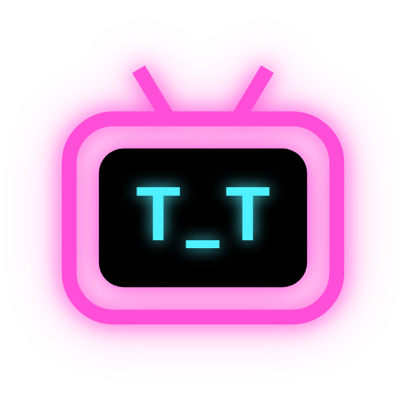
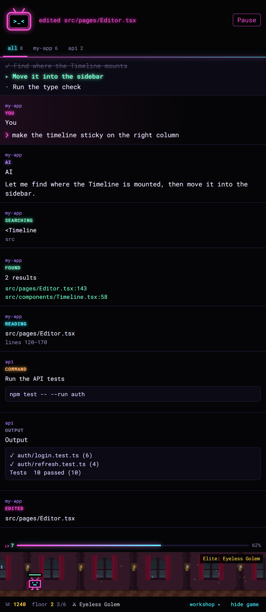

<p align="center">
  
</p>

<h1 align="center">bot_tv</h1>

<p align="center">
  <b>your agent is coding. put it on tv.</b><br>
  <sub>watch Claude Code work, live in VS Code: every read, search, command and edit.</sub>
</p>

<p align="center">
  
  
  
  
</p>

<p align="center">
  <a href="#install">install</a> ·
  <a href="#whats-on">what's on</a> ·
  <a href="#how-it-works">how it works</a> ·
  <a href="#hack-on-it">hack on it</a> ·
  <a href="#crew-wanted">crew wanted</a>
</p>

<br>

<table>
<tr>
<td width="52%" valign="top">

You ask Claude Code for something and it goes off: greps twelve files, reads half of them, runs a few commands, edits three things, says it's done. All you got was a wall of tool calls in a terminal.

**bot_tv turns that into a channel.** Keep VS Code open next to the terminal and the editor follows the agent around. It jumps to the lines Claude is reading, lights up what a search found and opens the diff the second an edit lands.

The side panel runs the broadcast: your prompt, what the agent says between steps, its plan, every command with its output, every result one click away.

Pair programming, except you're the one looking over the shoulder.

</td>
<td width="48%" valign="top">

</td>
</tr>
</table>

## install

Two pieces: a Claude Code plugin that sends the events, and a VS Code extension that shows them.

```text
/plugin install bot-tv --marketplace chillrod/bot-tv
```

Say `y` to add the marketplace and pick a scope. Then, still in Claude Code:

```text
/bot-tv-vscode
```

That installs the extension that ships inside the plugin. Reload VS Code and hit the little TV in the activity bar.

<sub>From a shell instead: `claude plugin install bot-tv --marketplace chillrod/bot-tv`, then `code --install-extension bot-tv.vsix` from the plugin folder.</sub>

> **best seat in the house:** run Claude Code in a terminal *outside* VS Code. Jumps and diffs grab the editor focus, and you don't want that where you're typing.

## what's on

**the editor follows.** Reads open at the exact lines. Searches (`Grep`, `Glob`, and plain `grep` / `rg` / `sed` / `head` / `cat` in Bash, `cd` included) jump to the first hit and light up the rest. Edits open as a before → after diff with the new code selected. A tool that fails shows up as failed, never as a fake diff.

**the feed narrates.** Prompt, agent messages, the plan with the current item, commands and their output, subagents, failures, done. Steps are paced (700 ms by default) so it plays like a replay, not a strobe light.

**one tab per project.** Got Claude running in more than one folder? Each gets a tab the moment it starts working. `flow…` follows everything, a project tab follows only that one, and the rest blink a dot when something happens there. The editor only moves for the tab you're on.

**the robot levels up.** MMO-style. Every second the agent spends working (prompt to done) is 1 XP, and levels follow the Tibia curve: lv 2 at 100 XP, lv 10 at 9,300, lv 50 at about 1.8M, each level asking more than the last. No cap. The badge and bar live under the robot and show `xp / xp`; hover for the totals. Sessions left idle don't farm XP. Nice try.

**it tells you when it updated.** After the extension updates, a pulsing `★ updated to vX` badge sits in the panel until you click it away.

**the robot reacts.** `o_o` reading · `O_O` searching · `^o^` found it · `>_<` editing · `^_^` done · `T_T` something broke · `★_★` level up.

**the look.** Deep black, neon pink and cyan, a little glow, all Roboto Mono. Want the whole editor in it? Pick **bot_tv Vaporwave** in *Preferences: Color Theme*. Want it calm? `"botTv.skin": "vscode"` and the panel follows your theme.

**the language.** English or Portuguese, matching your VS Code (which matches your system unless you changed it). Force one with `"botTv.language": "en" | "pt-BR"`.

## how it works

```text
Claude Code ──▶ plugin (hooks/register.ts) ──▶ POST 127.0.0.1:7337 ──▶ VS Code extension ──▶ editor + panel
```

The plugin is a Claude Code hooks module. It hears prompts, the agent's text, every tool call (before and after it runs) and the end of each turn, and posts them to localhost. Right before an edit runs, the extension snapshots the file, so the diff you see is the real one.

Nothing leaves your machine. VS Code closed? The plugin shrugs and Claude carries on.

## hack on it

```bash
npm run setup     # install the extension's dev dependencies
npm test          # compile + parsing/level checks + plugin tests (needs the claude CLI)
npm run package   # build bot-tv.vsix
```

- extension: TypeScript in `extension/src`, compiled to `extension/out`. Try it with `code --extensionDevelopmentPath=./extension <some project>`.
- plugin: `hooks/register.ts`. Load it with `claude --plugin-dir .`.
- `GET http://127.0.0.1:7337/status` says what the extension last showed. Handy when you can't see the screen.
- Node 22.18+.

## rough edges

- one VS Code window owns the port at a time; a second one says "port in use"
- tabs are per folder, so two sessions in the same folder share one
- XP lives in VS Code's storage on your machine. New machine, new robot
- the agent's private reasoning never shows up, only what it writes. Claude Code doesn't hand it over
- the plugin rides the hooks-module API (Claude Code 2.1.275+), still early access
- English and Portuguese only. Another language is one block in `extension/src/i18n.ts`
- Claude Code only for now. A Codex adapter just needs to post the same events

## crew wanted

bot_tv is free and open source, made for fun. It's looking for a couple of **fixed collaborators**: people who'd like to own the PR pipeline (review, CI, releases) and handle publishing (VS Code Marketplace, Open VSX, the plugin marketplace).

If that's you, email **[chillrod77@gmail.com](mailto:chillrod77@gmail.com)** with your GitHub handle and the part you'd like to own.

Drive-by PRs and issues are welcome too, no email needed.

## license

MIT
