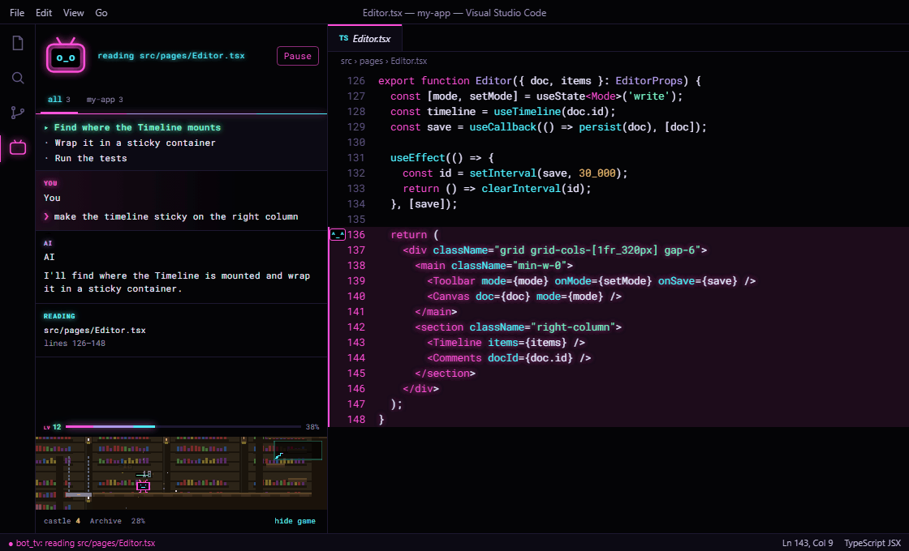
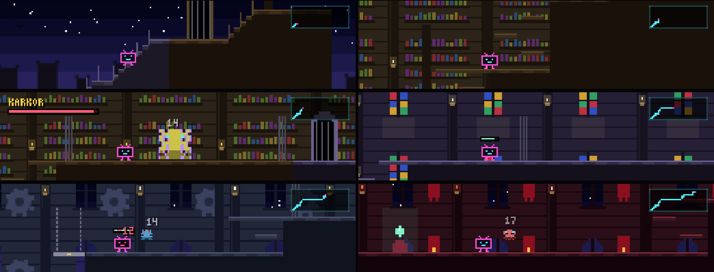

<p align="center">
  
</p>

<h1 align="center">bot_tv</h1>

<p align="center">
  <b>your agent is coding. put it on tv.</b><br>
  <sub>watch Claude Code work, live in VS Code: every read, search, command and edit.</sub>
</p>

<p align="center">
  
  
  
  
</p>

<p align="center">
  <a href="#what-the-robot-does">what the robot does</a> ·
  <a href="#install">install</a> ·
  <a href="#the-panel">the panel</a> ·
  <a href="#the-arcade">the arcade</a> ·
  <a href="#settings">settings</a> ·
  <a href="#how-it-works">how it works</a>
</p>

<br>

<p align="center">
  
  <br>
  <sub>one task, start to finish, and the session picker at the end. The panel on the left is the real one; the editor is drawn in the bot_tv Vaporwave theme.</sub>
</p>

<br>

You ask Claude Code for something and it goes off: greps twelve files, reads half of them, runs a few commands, edits three things, says it's done. All you got was a wall of tool calls scrolling by in a terminal.

**bot_tv turns that into a channel.** Keep VS Code open next to the terminal, open the TV in the activity bar, and the editor follows the agent around while the panel narrates. You see the folders it looks through, the exact lines it reads, what its searches found and every change the moment it lands.

Pair programming, except you're the one looking over the shoulder.

## what the robot does

Every step Claude takes shows up twice: in the editor, where it happened, and in the panel, as a line in the broadcast.

| when Claude… | the editor | the panel |
| --- | --- | --- |
| **reads** a file | opens it at the exact lines, lit up in neon, with the robot in the gutter | `reading`, the file and the line range |
| **searches** (`Grep`, `Glob`, `grep` / `rg` in Bash) | jumps to the first hit and lights up the rest of that file | the query, then every hit as a clickable `file:line` |
| **edits** (`Edit`, `Write`, `MultiEdit`) | opens a before → after diff with the new code selected | the lines that changed: red out, green in |
| **browses folders** (`ls`, `dir`, `tree`, `find`, `Get-ChildItem`, a lone `cd`, `Glob`) | opens the folder as a tree, even outside the project; `Glob` marks what matched with ●; every entry is clickable | the folder and how many folders and files it holds |
| **runs a command** (Bash or PowerShell) | a read (`cat`, `sed -n`, `head`, `tail`, `Get-Content`) opens that slice; a change (`sed -i`, a script, `cat > file`) opens the file's diff | the command and its output; long ones fold after 8 lines |
| **fails** | nothing moves, no fake diff | the failure, in red, with the error |
| **plans** (`TodoWrite`) | | the checklist, current item glowing |
| **talks** | | your prompt and what the agent says between steps |
| **finishes** | | `done`, and a happy robot |

The robot's face keeps up: `o_o` reading · `O_O` searching · `^o^` found it · `>_<` editing · `^_^` done · `T_T` something broke · `★_★` level up or boss down.

Steps play at a human pace (700 ms each by default) so it reads like a replay, not a strobe light. Clicking any file in the feed takes you there.

The editor only follows **while the TV panel is open**. Close it and the editor is yours again; steps keep landing in the feed for when you come back.

> **best seat in the house:** run Claude Code in a terminal *outside* VS Code. Jumps and diffs move the editor, and you don't want that where you're typing.

## install

Two pieces: a Claude Code plugin that sends the events, and a VS Code extension that shows them. In Claude Code:

```text
/plugin marketplace add chillrod/bot-tv
/plugin install bot-tv --marketplace chillrod/bot-tv
/bot-tv:bot-tv-vscode
```

The first line registers this repo as a marketplace, the second installs the plugin, the third installs the VS Code extension that ships inside it (type the whole name; if it says unknown command, run `/reload-plugins`). Reload VS Code and hit the little TV in the activity bar.

<sub>From a shell instead: `claude plugin marketplace add chillrod/bot-tv`, then `claude plugin install bot-tv --marketplace chillrod/bot-tv`, then `code --install-extension bot-tv.vsix` from the plugin folder.</sub>

Updating: `/plugin` updates the plugin, not the extension. When the plugin runs ahead, the panel shows a `⚠ plugin vX is newer` badge: run `/bot-tv:bot-tv-vscode` again and reload VS Code. After an update, a `★ updated to vX` badge says what's new until you click it away.

## the panel

**one session at a time.** Got more than one Claude Code session open? The panel follows one: the first that shows up, until you pick another. The `>_` button next to Pause lists every session with its folder, the start of its first prompt and when it last did something; sessions working out of sight get a green dot. Pick one and the feed, the robot and the editor switch to it. `all sessions` is there too, if you ask for it. A session you follow that goes quiet for 10 minutes hands over to the next one that gets a prompt.

**the robot levels up.** Every second the agent spends working, from prompt to done, is 1 XP. Levels follow the Tibia curve: lv 2 at 100 XP, lv 10 at 9,300, lv 50 at about 1.8M, each one asking more than the last, no cap. The level and a thin XP bar sit on top of the arcade; hover for the numbers. Sessions left idle don't farm XP. Nice try.

**the look.** Deep black, neon pink and cyan, a little glow, all Roboto Mono. Want the whole editor in it? Pick **bot_tv Vaporwave** in *Preferences: Color Theme*. Want it calm? `"botTv.skin": "vscode"` and the panel follows your theme.

**the language.** English or Portuguese, matching your VS Code. Force one with `"botTv.language": "en" | "pt-BR"`.

## the arcade

<p align="center">
  
</p>

A strip at the bottom of the panel plays a gothic castle climb on its own. Nothing to click, nothing to grind.

- **every castle is new.** Generated on the spot, with a name. The robot starts at the ramparts and works its way up, area by area: great hall, archive, chapel, crypts, bell tower.
- **it climbs.** Corridors, staircases, shafts it jumps up platform by platform, lifts it rides. Area names show up as it walks in, and a minimap fills in as it explores.
- **bosses.** Each area has a guardian with a name and a health bar. At the top of the throne spire waits the lord of the castle. Beat it, *castle conquered*, and the next castle starts. It never ends.
- **Claude joins the fight.** A read is a slash, a search is three, an edit is a heavy hit, a passing command heals, a failing one knocks the robot back.
- **it gets harder.** Monsters scale with every castle and with your level. The robot can take a beating: it gets knocked down and gets back up, but it never dies, so the climb always goes on.

Not your thing? `hide game` keeps the level bar and drops the rest.

## the weather

Set your city and the arcade's sky follows the real weather, from [Open-Meteo](https://open-meteo.com) (no key, no account):

```json
"botTv.weatherCity": "São Paulo"
```

Rain falls past the castle windows, storms flash, snow drifts. And when Claude sits idle for two minutes, the TV switches channels to an 80s-style **local forecast**: blue gradient, yellow numbers, five days and a crawl at the bottom. Any step, or a click, switches it back to the feed.

Left empty, it's off, and the sky changes on its own every minute or two.

## settings

| setting | default | what it does |
| --- | --- | --- |
| `botTv.skin` | `vaporwave` | `vaporwave` (neon on black) or `vscode` (follows your theme) |
| `botTv.language` | `auto` | `auto`, `en` or `pt-BR` |
| `botTv.weatherCity` | empty | your city, for real weather and the forecast channel; empty = off |
| `botTv.stepMs` | `700` | how long each step stays on screen, in ms |
| `botTv.port` | `7337` | local port the plugin sends events to |

## how it works

```text
Claude Code ──▶ plugin (hooks/register.ts) ──▶ POST 127.0.0.1:7337 ──▶ VS Code extension ──▶ editor + panel
```

The plugin is a Claude Code hooks module. It hears prompts, the agent's text, every tool call (before and after it runs) and the end of each turn, and posts them to localhost. Right before an edit or a command runs, the extension snapshots the files involved, so the diff you see is the real one.

Nothing leaves your machine, unless you set `botTv.weatherCity`: then the city name goes to Open-Meteo every 30 minutes. VS Code closed? The plugin shrugs and Claude carries on.

## hack on it

```bash
npm run setup     # install the extension's dev dependencies
npm test          # compile + parsing/level/weather checks + plugin tests (needs the claude CLI)
npm run package   # build bot-tv.vsix
```

- extension: TypeScript in `extension/src`, compiled to `extension/out`; the panel is `extension/media/feed.html`, the arcade `extension/media/game.js`. Try it with `code --extensionDevelopmentPath=./extension <some project>`.
- plugin: `hooks/register.ts`. Load it with `claude --plugin-dir .`.
- `GET http://127.0.0.1:7337/status` says what the extension last showed. Handy when you can't see the screen.
- Node 22.18+.

## rough edges

- one VS Code window owns the port at a time; a second one says "port in use"
- a command's changes show up only for files it names, with an extension (`a.ts`, `notes.md`)
- a restarted Claude Code session is a new session; the panel follows it once you pick it (or once the old one goes quiet)
- XP and the robot's place in the castle live in VS Code's storage on your machine. New machine, new robot
- the arcade pauses while the panel is out of sight and picks up where it stopped
- the agent's private reasoning never shows up, only what it writes. Claude Code doesn't hand it over
- the plugin rides the hooks-module API (Claude Code 2.1.275+), still early access
- English and Portuguese only. Another language is one block in `extension/src/i18n.ts`
- Claude Code only for now. A Codex adapter just needs to post the same events

## crew wanted

bot_tv is free and open source, made for fun. It's looking for a couple of **fixed collaborators**: people who'd like to own the PR pipeline (review, CI, releases) and handle publishing (VS Code Marketplace, Open VSX, the plugin marketplace).

If that's you, email **[chillrod77@gmail.com](mailto:chillrod77@gmail.com)** with your GitHub handle and the part you'd like to own.

Drive-by PRs and issues are welcome too, no email needed.

## license

MIT
